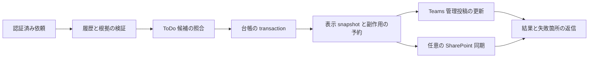

# Teams の ToDo と共有記録の設計案

作成日: 2026-10-26。対象候補: `004-teams-work-management`。状態: 設計案、未実装。

Teams の標準チャネルで、会話から抽出した ToDo の登録・完了・リマインドを扱い、まとめを更新可能な共有記録に残す。Firestore を ToDo 状態の正本とし、Teams の一覧投稿と、任意の SharePoint List へ表示を反映する。

003 の実接続確認 T014 は独立して残す。今回の設計によって完了とはしない。個人・グループチャット、private/shared channel、リアクションによる合意・完了判定は対象外。

## 1 採用する構成

| 領域 | 初版の設計 | 理由 |
| --- | --- | --- |
| ToDo 状態 | Teams 専用 Firestore コレクション | 既存 Slack の全件検索と DM 送信に混入させない |
| ToDo 操作 | 元スレッドの一覧カードと明示コマンド | 人と対象を認証・照合してから変更する |
| リマインド | 元スレッドへ営業日 09:00 JST に集約 | personal scope や個人 DM の新規導入を必要としない |
| Teams 内の記録 | スレッドごとのボット所有の更新投稿 | 追加の Graph 書込み権限なしで始められる |
| 外部の共有記録 | 任意の SharePoint List、1スレッド1行 | チャネルを横断せず、担当者・期限・人のメモを分けて保持できる |
| Planner と Microsoft To Do | 初版には接続しない | 外部タスクとの二重管理と広い追加権限を避ける |

Teams 内の記録投稿は Slack canvas の共同編集機能を再現しない。チャネル横断の一覧は SharePoint List のビューで提供し、Teams へのタブ追加は利用者が行う。独自 Web タブ、Loop、SharePoint ページの自動生成は後続候補とする。

Planner のタスク作成と Microsoft To Do のリスト作成には app-only の `Tasks.ReadWrite.All` が使える。「アプリ認証では不可能」という理由で除外しない。初版の除外は権限と整合性の設計判断である。[Planner 作成 API](https://learn.microsoft.com/en-us/graph/api/planner-post-tasks?view=graph-rest-1.0)、[To Do 作成 API](https://learn.microsoft.com/en-us/graph/api/todo-post-lists?view=graph-rest-1.0)

## 2 利用者の操作

下記は新しい契約案。現在のコマンドが既に対応していることを意味しない。

| 操作例 | 動作 |
| --- | --- |
| `@arbalest まとめて` | 概要を返信。条件を満たす ToDo を登録し、調整事項がある場合に記録投稿も更新 |
| `@arbalest 返信だけでまとめて` | 返信のみ。ToDo 登録と共有記録の更新を抑止 |
| `@arbalest todo` | スレッドの抽出候補と登録済み ToDo を表示 |
| 候補の「登録」 | 表示済みの検証済み候補を明示登録。担当未定も可 |
| ToDo の「完了」／`@arbalest done T12` | 担当者または最初の登録者が、指定した1件を完了 |
| `@arbalest canvas` | 現在のまとめを記録投稿へ反映。外部記録が有効なら List にも同期 |
| `@arbalest 通知停止`／`通知再開` | 元スレッド単位の通知を変更。最初の管理操作の依頼者だけが操作可能 |
| `@arbalest findings 7` | 期間の振り返りを返信。永続 ToDo と記録の自動更新は行わない |

`T12` はスレッド内で単調増加する表示番号。現在のスレッド以外の番号には解決しない。自然文で「終わった」と分析されたことや、抽出結果の `closed` だけでは登録済み ToDo を完了にしない。取消・再開・担当者の手動変更は初版の対象外とし、必要なら後続で監査付き操作を追加する。

自動登録の条件は、根拠一致、担当者が取得会話の参加者に存在、`needsReview=false`、`certainty=explicit`、未完了候補であること。期限は未定でもよい。候補の明示登録でも根拠不一致は許さない。担当未定は「登録者が管理」と表示し、通知は元スレッドへ送る。

002 と同じく、自動記録は検証された調整事項（topic、未完了 ToDo、未解決の問い）がある場合だけにする。概要しかない会話は返信だけとする。明示 `canvas` はこの条件にかかわらず記録できる。

依頼文の `suppressTodo` / `suppressCanvas` を副作用ごとに適用する。`canvas` は ToDo を新規登録しない。`todo` は外部記録を新規作成しない。完了による既存記録の状態反映は行う。抑止された操作の裏で別の副作用を新規に有効化しない。

## 3 現在の実装との差

- `src/teams/job.ts` は毎回 `analyze({ prior: null })` を使う。抽出項目 `t1` 等を永続 ToDo ID に流用すると、次回は別の作業に同じ ID が割り当たり得る。
- `src/teams/graph.ts` の `sourceIds` は分析用時刻から生 ID への対応だけを保持する。永続根拠には、tenant/team/channel/root/親か返信か/id の組が必要。
- `src/store/types.ts` の `TodoDoc` は Slack の `threadTs` / `listMessageTs` / `sourceTs` を前提とする。既存 `findDueForReminder` はプラットフォームで絞らず、`src/worker/jobs/reminders.ts` は Slack DM を送る。
- `src/teams/runtime.ts` は現在 `message` イベントだけを扱う。カード操作の認証・受付・キュー投入を追加する必要がある。
- 既存の返信 snapshot は `summary:N` 専用。管理操作の進捗を同じ形式へ無条件に追加しない。

共通分析、根拠検証、JST の期限判定の純粋関数を再利用する。Slack の ToDo・canvas・通知ジョブは直接呼ばず、Teams 専用ストアと送信アダプターに接続する。

## 4 永続 ID と再分析の照合

### D1 元メッセージの識別

`MessageRef = { tenantId, teamId, channelId, rootMessageId, kind: root|reply, messageId }` を保存する。UUID は小文字に正規化し、Teams の不透明 ID は大文字小文字を含めて維持する。分析用時刻と `p1` 等の参加者番号を永続キーにしない。

`TeamsConversation` に分析用 ID → `MessageRef` の対応を追加する。根拠は `MessageRef`、検証済み引用、取得時のリンクを保持する。本文全体は新しい ToDo コレクションへ複製しない。リンク生成・検査はコードで行う。

### D2 ToDo の同一性

永続 `todoId` は登録時に生成し、スレッド内表示番号とは分離する。別の anchor 索引に、`MessageRef` と正規化した引用の組、確認済み作業本文のハッシュを保存する。正規化は空白等に限定し、否定語・数字・日付を消さない。

1. 同一の元メッセージ・引用・作業本文に、候補と既存項目がそれぞれ1件だけ一致した場合に ID を継承する。
2. 期限や担当者の差分は「更新候補」にし、既存の担当者または登録者が確認するまで反映しない。
3. 同じ引用から複数作業が抽出された場合、本文が変わった場合、根拠の編集・追加で対応が変わった場合は自動統合しない。候補カードで既存 ToDo への関連付けか別件登録を選ぶ。
4. 一致候補がない新しい根拠だけを新規登録候補にする。既存根拠と重なる曖昧候補は自動登録しない。
5. 再分析で消えた ToDo、削除された根拠、履歴取得失敗を理由に、登録済み項目を自動削除・完了にしない。

完了済み項目の再抽出は完了のまま表示する。AI による意味の近さだけで ID を継承しない。既存 `carryOverIds` の文面照合だけに永続台帳の同一性を任せない。

### D3 Teams 専用の保存

| コレクション案 | 主な値 |
| --- | --- |
| `teams_todos` | todoId、targetId、scope、displayNo、根拠、text、assigneeAadId、createdByAadId、dueIso、status、revision、doneBy、doneAt |
| `teams_todo_anchors` | scope を含む anchor のハッシュ、todoId、照合履歴 |
| `teams_thread_settings` | scope、認証済み serviceUrl/conversationId、管理者 Aad ID、通知有効フラグ |
| `teams_records` | targetId、desiredRevision、投稿の activity ID と slot、外部 item ID、etag、appliedRevision、失敗状態 |
| `teams_effects` | operationId、scope、固定表示 snapshot、送信 slot、状態、lease/fencing token |
| `teams_action_refs` | ランダム token のハッシュ、対象、許可操作、revision、期限、元の投稿 ID |

scope は tenant/team/channel/root を保持し、索引と認可の双方で検査する。ToDo の `open → done`、採番、anchor 確保、通知予約は Firestore transaction で行う。変更はメモリ・Firestore の両実装に共通契約テストを持つ。

アプリの保持期間は原則90日。登録・人による更新・完了から90日とし、自動分析・通知・表示更新で延長しない。期限到来後は TTL 削除を待たず、アプリ側で操作と通知を拒否する。90日を超えた根拠から自動再登録しない。Teams 投稿と SharePoint 記録の保持は各サービスの組織ポリシーに従い、Firestore TTL が外部記録も消すとは扱わない。

## 5 認証と完了操作

カードは `Action.Execute` を第一候補とする。公式資料は対応と推奨を示しているが、導入済み SDK 2.1.1 の handler・応答契約はローカル型定義と合成 HTTP テストで確定する。[カード操作](https://learn.microsoft.com/en-us/microsoftteams/platform/task-modules-and-cards/cards/cards-actions)

カードの値には操作参照 token だけを入れる。操作内容・宛先・操作者をクライアント値から信用しない。SDK が認証した activity から tenant/team/channel、操作者の `aadObjectId`、元カードの ID を取り、保存済み参照に一致することを検証する。カードの操作イベントにはメンションを要求しない。署名検証と scope 検査は必須。

有効期限は発行から7日か台帳の保持期限の早い方。古いカードは一覧の再取得を案内する。期限内でも ToDo の revision が異なれば再表示し、古い担当者や期限を適用しない。token をコピーしても、操作者と実際の会話 scope が一致しなければ拒否する。

軽い検証とキュー投入までを受付で行い、invoke への応答は SDK の制限内に返す。worker で有効期限・scope・最新 revision・権限を再検証し、担当者または登録者だけが完了可能とする。二重クリックと別イベントの同時操作でも `changed=true` は1回だけ。完了済みへの再操作は成功済みとして扱う。

拒否理由は操作応答内に出す。Teams の非公開応答が使用できない経路では、チャネルへ人物・ToDo 内容を含む拒否通知を新規投稿しない。明示コマンドには簡潔な拒否返信を返す。

## 6 リマインド

初期値は管理対象スレッドの通知有効、営業日 09:00 JST。営業日は月〜金、祝日除外は初版に含めない。期限が次の営業日までの未完了項目を含み、期限未定は月曜だけ通知する。次営業日の計算は既存の純粋関数と契約を確認して共有する。

元スレッドにつき1日1組に集約する。担当者は表示名とし、初版は `@mention` を付けない。個人宛の通知は保証しない。通知には受信理由、期限、根拠リンク、完了方法、通知停止方法を含める。元スレッドの認証済み会話参照を保存し、実行時にも tenant/team allowlist と無効化状態を再検証する。

bot の proactive 投稿には対象チームへの導入と会話参照が必要。[能動メッセージ](https://learn.microsoft.com/en-us/microsoftteams/platform/bots/how-to/conversations/send-proactive-messages)

operationId は JST 日付・targetId・操作種別だけから決め、transaction で1日1件を予約する。snapshot は予約内に保存し、snapshot の変更から別の予約を作らない。同じ日の追加・変更は翌営業日へ回す。送信直前に完了・停止・期限切れを再確認し、対象がなくなれば送信しない。分割時は slot ごとに記録し、成功した slot を再送しない。

送信成功後の保存前に停止すると重複が残る。予約は同時実行を防ぐが、Teams 送信の厳密な一度だけ実行を保証しない。送信と同時の完了操作により、直前の状態の通知が届く窓も残る。401/403 は通知を停止して要再接続とし、404 は対象を無効化する。429 は Retry-After に従い、5xx は上限付き再試行。別チャネル・DMへの自動迂回はしない。

## 7 canvas 相当の共有記録

### D4 Teams 内の更新投稿

スレッドごとに1組の管理投稿を作り、概要・決定・未決定・ToDo・問い・根拠リンク・更新日時を表示する。ToDo 状態は分析結果へ台帳を重ねて作る。更新はボットが送った activity だけを対象にする。[メッセージ更新](https://learn.microsoft.com/en-us/microsoftteams/platform/bots/build-conversational-capability)

`TeamsReply` の現在の `string | void` は管理投稿には不十分。新しい writer は activity ID の返却を必須にし、ID 欠損を成功扱いしない。投稿と更新を分離し、scope と bot 所有を確認してから更新する。削除済み投稿の再作成は、明示的な再取得・canvas 操作時だけ行う。

新規作成前に `creating` を保存する。送信後に activity ID を保存できなかった場合や、`creating` のままリースが失効した場合は `delivery_unknown` とし、通常の再試行で新規投稿しない。管理者が実際の投稿を確認して ID を再関連付けするか、重複が残る可能性を承知して明示再作成する。既存 ID への更新再試行とは区別する。

表示が上限を超えたら安定した slot に分割する。slot 数が減ったときは余った管理投稿を「この内容は統合済み」に更新する。省略を完全な記録と表示しない。

### D5 SharePoint List の外部記録

専用 List を管理者が事前作成し、設定に tenant/team/channel と siteId/listId の対応を固定する。ボットによるサイト探索、任意 URL の保存先指定、リストやタブの自動作成は行わない。

1スレッド1行を基本とし、一意・索引付きの `ArbalestKey` と、`Title`、`ThreadUrl`、`Overview`、`Decisions`、`OpenIssues`、`Todos`、`Questions`、`Evidence`、`GeneratedAt`、`Revision`、`UserNotes` を持つ。生成列はプレーンテキストとし、`UserNotes` は人だけが編集する。Rich Text を必須にしない。

`ArbalestKey` は scope のハッシュで、API 作成成功後に応答を失っても検索して再利用する。一意制約の競合時も再検索する。許可された列だけを PATCH し、取得した etag を `If-Match` に渡す。412 は再取得し、人のメモだけの変更なら生成列の変更を再適用する。[List 作成](https://learn.microsoft.com/en-us/graph/api/listitem-create?view=graph-rest-1.0)、[List 更新と競合検知](https://learn.microsoft.com/en-us/graph/api/listitem-update?view=graph-rest-1.0)

外部呼出しの前に、送信予定の生成列 snapshot・hash・revision を保存する。復旧時の実データが送信予定 hash/revision と一致すれば、応答を失った自分の更新として適用済みにする。前回適用済みの hash と一致すれば未適用として再試行する。どちらにも一致しない場合だけ `conflict` とし、人の編集を自動上書きせず、スレッドに修復が必要と示す。

各生成列のアプリ側上限を8,000文字とする。超過時は外部更新を止め、既存の記録を維持して `too_large` を通知する。勝手に切り捨てたり、別の文書へ出力しない。チャネル用ビューから元スレッドと根拠を開ける構成とする。

権限は `Lists.SelectedOperations.Selected` と専用 List への `write` 付与を第一候補にする。同意だけではアクセスできず、リソース単位の付与も必要。付与に使う管理者の権限を実行ボットへ渡さない。[Selected 権限](https://learn.microsoft.com/en-us/graph/permissions-selected-overview)

個別の List 作成・更新 API の権限表は `Sites.ReadWrite.All` を記載している一方、Selected 権限の概要は List 単位の app-only 書込みを説明している。テスト環境で Selected 権限のみの GET・検索・POST・PATCH・412、他 List の拒否を確認するまで外部記録を有効化しない。失敗時に全サイト権限へ自動拡大しない。

外部記録は標準チャネルの参加者と同じ利用範囲の List に限る。List の閲覧範囲がチャネルと一致することを管理者が導入前に確認する。誤共有が判明したら同期を停止し、既存行の公開範囲と削除を管理者が処理する。無効化だけでは既に保存した内容は消えない。

## 8 処理順序と復旧

分析、登録、管理投稿、外部同期、結果返信を別の進捗として保存する。ToDo の変更と同期予定の登録は同じ transaction に含める。外部 API は transaction 内で呼ばない。共有記録の正本となる revision ごとの表示を固定し、再試行で LLM を再実行しない。保存 snapshot は既存と同様256KiB以下に制限する。

同じ targetId の更新を直列化する。リース延長・所有 token の検査で期限切れ worker の保存を拒否し、desiredRevision より古い同期は送信前に中止する。Teams の更新 API には Firestore との原子的な revision 比較がないため、古い送信が遅れて完了する窓は残る。定期修復で最新 revision を再適用する。SharePoint は etag も併用する。

| 障害 | 保存する結果と復旧 |
| --- | --- |
| 履歴不完全・根拠不一致 | 登録・外部更新をしない。既存台帳は維持 |
| 台帳成功、一覧更新失敗 | 完了等の状態は保持。表示更新だけ再試行 |
| Teams 成功、SharePoint 失敗 | Teams の結果に外部記録失敗を表示。外部同期だけ再試行 |
| SharePoint に人の生成列編集 | conflict を保持。人の編集を確認してから明示再同期 |
| SharePoint 更新成功後の応答紛失 | 送信予定 hash/revision と実データを照合し、適用済みに回復 |
| Teams 管理投稿の作成結果不明 | delivery_unknown を保持。自動新規投稿を止めて確認・再関連付け |
| キュー投入失敗 | 成功と返さない。再操作できる応答を返す |
| 再試行上限 | pending/failed を保持。最新 revision を使う修復ジョブの対象にする |
| 機能無効化・アプリ削除 | 送信・新規登録を停止。記録を自動削除しない |

将来の設定案は `TEAMS_TODO_ENABLED`、`TEAMS_REMINDERS_ENABLED`、`TEAMS_RECORD_MODE=off|message|sharepoint`。既定は無効、外部記録は利用者の導入確認後に有効化する。設定名は実装時に `src/config.ts` の既存契約と合わせて確定する。

## 9 実装単位と受入条件

以下は順番に実装するテストと実装の対。まだ実装タスクを完了にしない。正式な feature 化時に spec/plan/contracts/tasks へ移す。

| 順序と候補 ID | テストと実装の対 | 参照と受入条件 |
| --- | --- | --- |
| W01 | `tests/unit/teams-graph.test.ts` と `src/teams/graph.ts` / `types.ts` | D1。同じ生ID・同時刻・別root・親返信を区別して永続根拠へ変換 |
| W02 | `tests/unit/teams-todo-identity.test.ts` と `src/teams/todo-identity.ts` | D2。順序変更でも同一性を維持、曖昧照合を隔離、完了を誤継承しない |
| W03 | `tests/shared/teamsStoreContract.ts` と専用メモリ/Firestore repo | D3。原子的採番・登録・完了、期限拒否、Slack の検索・送信へ混入0件 |
| W04 | `tests/unit/teams-actions.test.ts` と `src/teams/actions.ts` / `runtime.ts` | §5。別tenant・転送カード・token改変・期限切れ・無権限拒否、二重完了1回 |
| W05 | `tests/integration/teams-todos.test.ts` と `src/teams/todos.ts` / `job.ts` | §2。登録条件、抑止、明示候補、変更確認、再分析時の重複防止 |
| W06 | `tests/unit/teams-records.test.ts` と `src/teams/records.ts` / `runtime.ts` | D4/§8。必須 activity ID、作成結果不明時の停止、slot更新、古い revision、表示失敗の独立再試行 |
| W07 | `tests/integration/teams-reminders.test.ts` と `src/teams/reminders.ts` | §6。金曜・月曜・期限未定・完了競合・停止・日次予約・分割送信の再開 |
| W08 | `tests/unit/teams-sharepoint.test.ts` と `src/teams/sharepoint.ts` | D5。Selected 前提のフェイク、POST/PATCH応答紛失、一意競合、412、人のメモ保持、生成列競合 |
| W09 | `tests/integration/teams-runtime.test.ts` と設定・worker接続 | §8。機能無効時の互換性、別workerへの混入拒否、部分失敗、snapshot上限 |
| W10 | 利用者による実接続と共有範囲確認 | 003 T014を先に確認。カード、能動返信、Selected CRUD、Teams desktop/web/mobile の表示を確認 |

各対で赤を確認してから実装する。共通エラー・型を変更する場合は参照テストを全プロジェクトから検索する。実資格情報を使う W10、実 AI、実 Firestore テストは利用者が実行する。

W01〜W07/W09 で ToDo と Teams 内記録を先に提供できる。W08/W10 の外部権限確認後に SharePoint を有効化する。最後にメインが lint・typecheck・全フェイクテスト・build を1回実行する。本番 GCP とインフラを変更しない。
